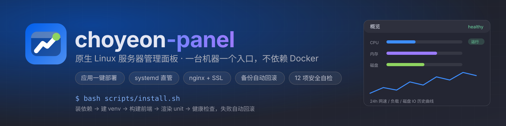
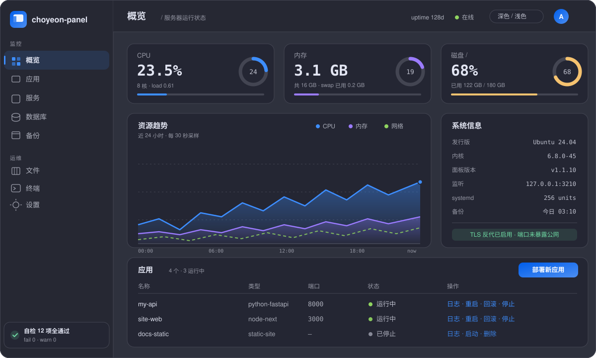
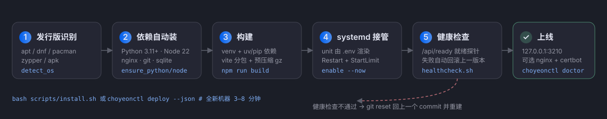
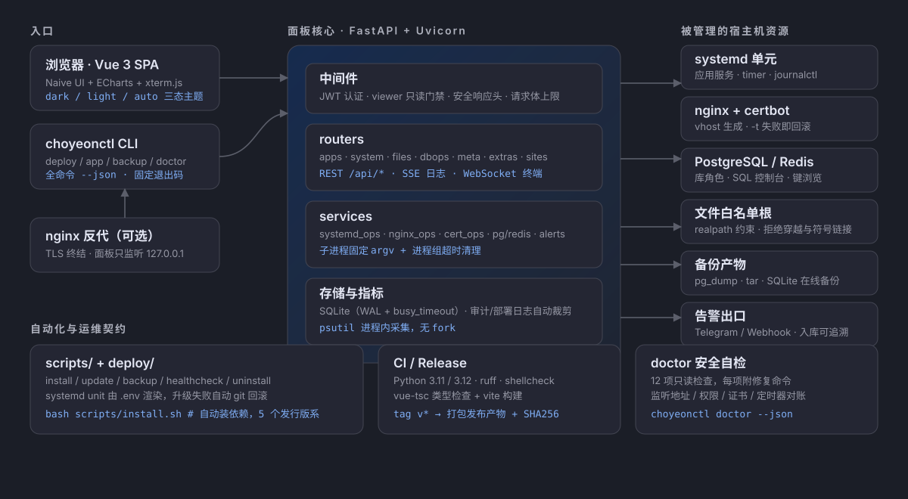
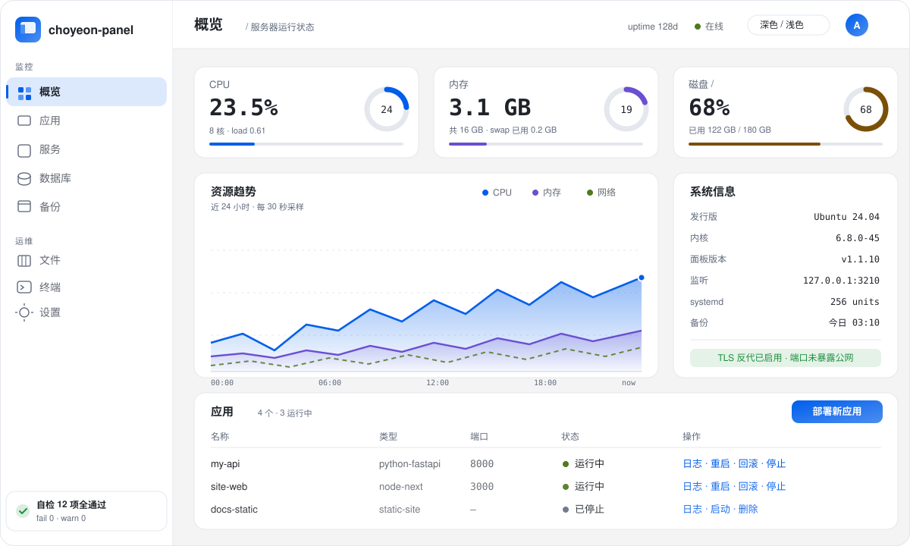

<p align="center">
  
</p>

<p align="center">
  <a href="#快速开始">快速开始</a> ·
  <a href="#为什么选它">为什么选它</a> ·
  <a href="#功能">功能</a> ·
  <a href="#架构">架构</a> ·
  <a href="#命令行">命令行</a> ·
  <a href="#faq">FAQ</a> ·
  <a href="CHANGELOG.md">更新日志</a> ·
  <a href="CONTRIBUTING.md">贡献指南</a> ·
  <a href="RUNBOOK.md">排障手册</a> ·
  <a href="AGENTS.md">AI 部署规则</a>
</p>

<p align="center">
  <a href="https://github.com/Choyeon/choyeon-panel/actions/workflows/ci.yml"></a>
  <a href="https://github.com/Choyeon/choyeon-panel/releases"></a>
  
  
  <a href="./LICENSE"></a>
  
  
</p>

> **原生 Linux 服务器管理面板 —— 一台机器一个入口，不依赖 Docker。**
> 一行脚本装完：应用部署与回滚、systemd 服务、nginx 站点、SSL 证书、PostgreSQL/Redis、备份、文件管理、Web 终端、12 项安全自检。
> Native Linux server admin panel: apps, systemd, nginx, SSL, databases, backups and a 12-point security doctor — **no Docker required**.

<p align="center">
  
</p>

---

## 为什么选它

买一台 VPS 之后，通常要同时在 SSH、systemctl、nginx 配置、certbot、pgAdmin、备份脚本之间来回切换。choyeon-panel 把这些收进一个页面，并且**直接管理宿主机的原生能力**——不引入容器层、不额外守护进程栈：

| | choyeon-panel | 常见 Docker 化面板 |
| --- | --- | --- |
| 运行时依赖 | Python 3.11+ / Node（仅构建期） | Docker Engine + 镜像仓库 + 容器网络 |
| 被管应用 | 宿主机 systemd unit，进程可见可 `journalctl` | 容器编排层，日志与端口多一跳 |
| 内存常驻 | 单 Uvicorn 进程（psutil 进程内采集，无 fork） | 面板 + docker daemon + compose 容器 |
| 安装 | `bash scripts/install.sh` 一行，自动装依赖 | 先装 Docker，再装面板 |
| 升级 | 备份 → 构建 → 健康检查 → **失败自动 git 回滚** | 拉镜像，失败需手工排障 |
| 数据落点 | 一个 SQLite 文件 + `.env`，可直接备份/迁移 | 分散在卷与容器内 |
| 面向自动化 | 全命令 `--json` + 固定退出码 + [AGENTS.md](AGENTS.md) | 多为网页优先 |

适合：个人服务器 / 小团队 VPS / 独立开发者把一个或多个站点跑在裸机上，想有个能审计、能回滚、能被脚本驱动的入口。

---

## 快速开始

### 支持的发行版

安装脚本自动识别发行版并**自动安装全部依赖**（含 Python 3.11+ 与 Node 20+）：

| 系 | 发行版 | 包管理 |
| --- | --- | --- |
| Debian | Debian 12+ / Ubuntu 22.04+ / Linux Mint / Kali | apt（Node 走 NodeSource 22 LTS） |
| RHEL | CentOS Stream 9+ / Rocky / AlmaLinux / Fedora / Amazon Linux | dnf/yum（Node 走 NodeSource 22 LTS） |
| Arch | Arch / Manjaro / EndeavourOS / CachyOS | pacman |
| openSUSE | Leap 15.6+ / Tumbleweed | zypper |
| Alpine | 3.20+（musl；无 systemd 时服务需手动启动） | apk |

其它发行版：脚本不会中断，但会跳过依赖安装并提示自行确认 `git / nginx / sqlite3`。

### 60 秒部署

```bash
git clone https://github.com/Choyeon/choyeon-panel.git
cd choyeon-panel && sudo bash scripts/install.sh
```

脚本依次完成：装系统依赖 → 建 venv → 构建前端 → 渲染 systemd unit → 启动并健康检查 → （可选）配置 nginx 反代与 certbot。

```bash
# 创建管理员（口令走 stdin，不要写在命令行参数里）
PW="$(openssl rand -base64 24 | tr -d '/+=' | head -c 20)"
printf '%s' "$PW" | sudo choyeonctl user create admin --password-stdin

sudo choyeonctl status --json     # "healthy": true
sudo choyeonctl doctor --json     # "counts": {"fail": 0}
```

然后打开 `http://127.0.0.1:3210`。**面板只监听回环地址**，公网访问请套 nginx + TLS（见第 4 步或 `deploy/nginx-panel.conf.example`）。

<p align="center">
  
</p>

可用环境变量覆盖：`CP_PREFIX`（默认就是脚本所在的仓库目录，仓库结构不完整时才退回 `/root/choyeon-panel`）、`CP_PORT`（3210）、`CP_DATA_DIR`、`CP_BACKUP_DIR`、`CP_APP_ROOT`、`CP_SKIP_NGINX=1`、`CP_SKIP_DEPS=1`。

部署参数的取值顺序统一为 **显式环境变量 > 安装目录的 `.env` > 内置默认**；`install.sh` 会把最终生效的值写回 `.env` 并渲染进 unit，两边不会各说各话。改配置的正确路径是编辑 `.env` 后执行 `choyeonctl upgrade --no-pull`（见 AGENTS.md 第 5 节）。

### 手动安装

```bash
cd choyeon-panel
cp .env.example .env && chmod 0600 .env       # 按需修改

cd web && npm ci && npm run build && cd ..    # 前端产物 → web/dist（后端直接托管）

cd backend && python3 -m venv .venv
.venv/bin/pip install -r requirements.txt     # 或 uv pip install --python .venv/bin/python -r requirements.txt

cp deploy/choyeon-panel.service /etc/systemd/system/
systemctl daemon-reload && systemctl enable --now choyeon-panel
```

### 升级 / 回滚

```bash
choyeonctl upgrade            # 拉代码 → 备份 → 构建 → 重启 → 健康检查，失败自动回滚上一个 commit
choyeonctl upgrade --no-pull  # 只改了配置时：跳过拉代码，仅重建并重新渲染 unit
```

---

## 架构

<p align="center">
  
</p>

三个设计决定塑造了整个结构：

1. **一个进程，两类入口。** 后端是单个 FastAPI/Uvicorn 进程，同时托管 SPA 静态产物与 `/api`；`choyeonctl` 复用同一套 service 层，所以网页能做的事终端也能做，不存在"只有 UI 里有"的能力。
2. **面板不代理，面板直管。** systemd、nginx、certbot、pg_dump 都在这台机器上被直接调用：exec 一律走参数数组 + 正则白名单，子进程统一 `start_new_session` 并在超时时 `killpg`。没有容器中间层，日志和进程状态就是机器本身的状态。
3. **状态只有一份，且可备份。** 面板自身数据是一个 WAL 模式的 SQLite 文件 + `.env`，全部在 `CP_DATA_DIR` 下；备份用 SQLite 在线备份 API，不用 `cp`。指标历史进同一个库，`doctor` 就查这些事实是否自相一致。

## 功能

| 模块 | 能力 |
| --- | --- |
| 应用管理 | Git 拉取 → 安装依赖 → systemd 托管部署 Node/Python 应用；环境变量、自定义启动命令、unit 模板、**一键回滚到上一次成功部署** |
| 一键模板 | 建应用时选预设（`node-service` / `node-next` / `python-fastapi` / `static-site`），自动填运行时、安装与启动命令、端口 |
| **安全自检** | 网页「安全自检」页与 `choyeonctl doctor`：监听地址、管理员、服务、前端产物、nginx、防火墙、备份、磁盘、文件权限、全局 CLI、**证书续期是否真有人托管**、**定时器单元与任务记录对账**共 12 项只读检查，每项给可复制的修复命令 |
| Nginx 集成 | 按域名/端口生成反代配置，开关 WebSocket 升级、请求体大小、重定向；`nginx -t` 校验后热加载，**校验失败自动回滚原文件** |
| SSL | certbot 签发/续期，到期天数告警；证书清单与「最早到期 N 天」在总览可见 |
| 系统监控 | psutil 进程内采集（无 fork）：CPU/内存/网速实时曲线 + **1h/6h/24h/7d 历史曲线**（磁盘、负载、磁盘 IO）、Top 进程；systemd 服务启停；journalctl 实时日志（SSE）与关键词检索 |
| 数据库 | PostgreSQL 库/角色管理 + SQL 控制台 + **表/行数据浏览（可编辑）**；Redis 键浏览器（string/hash/list/set/zset，含 TTL 与内存），读路径走进程内 RESP 客户端，不 fork redis-cli |
| 备份 | pg_dump / 目录打包 / SQLite 在线备份，daily/weekly 调度由 **systemd timer** 托管（列表直接显示下次触发时间），支持在线恢复、上传与下载备份文件 |
| 网站与证书 | 域名 × 应用 × 端口的反代总览（HTTPS/跳转/WebSocket 开关与配置文件名），证书清单含剩余天数与最早到期提醒，一键套用/移除 vhost、手动续期 |
| 日志中心 | 系统日志按 unit/时间/级别/正则关键词检索（journalctl 固定 argv），应用与面板日志尾读，命中高亮 |
| 文件管理 | 白名单根目录内浏览/编辑/**多文件上传**/下载/打包下载/解压/重命名/删除，带体积上限；上传按字节落盘，解压拒绝越界路径与符号链接 |
| Web 终端 | pty + xterm.js，仅管理员，带并发会话上限 |
| 用户与审计 | admin/viewer 两级（viewer 只读），全量操作审计日志（自动裁剪与脱敏） |
| 告警 | 磁盘水位、SSL 到期、服务掉线、CPU/内存/负载阈值、**应用 HTTP 探活** → Telegram / Webhook；告警入库可追溯、可确认 |
| 定时任务 | cron 表达式在面板里登记（渲染成 systemd timer），命令走固定 argv 白名单，可立即执行并留下末段日志 |

---

## 命令行

装完后 `choyeonctl` 会软链到 `/usr/local/bin`，网页端能做的事在终端同样能做——所有命令都支持 `--json`，退出码固定 `0 成功 / 1 失败 / 2 用法错误 / 3 前置条件不满足`，适合写进运维脚本或交给 AI 智能体执行。

```bash
choyeonctl deploy --port 3210 --json                 # 与 scripts/install.sh 等价的一键部署
choyeonctl status --json                             # 版本 / 监听 / 服务 / 健康 / 自检汇总
choyeonctl doctor --json                             # 12 项只读自检，每项带修复命令

printf '%s' "$PW" | choyeonctl user create admin --password-stdin --json
choyeonctl app templates                             # node-service / node-next / python-fastapi / static-site
choyeonctl app create my-api --template python-fastapi \
  --repo https://github.com/you/repo.git --port 8000 --json
choyeonctl app deploy --id 1 --json
choyeonctl app logs --id 1 --lines 80
choyeonctl backup run                                # SQLite 在线备份 API
choyeonctl schema --json                             # 输出命令契约（本表的权威来源）
```

完整参数与失败处置表见 [AGENTS.md](AGENTS.md)；排障细节见 [RUNBOOK.md](RUNBOOK.md)。

---

## 目录结构

```
backend/
  app/
    config.py          环境变量 → 类型化配置（含 .env 解析与取值范围钳制）
    templates.py       一键部署模板（网页端与 CLI 共用）
    routers/meta.py    /api/ready 就绪探针、/api/templates、/api/doctor 自检
    database.py        SQLite 封装：WAL、busy_timeout、审计与部署日志裁剪
    security.py        scrypt 口令、JWT（含按用户吊销版本号）、登录限速
    deps.py            认证中间件 + 统一安全响应头（CSP/HSTS/…）
    util.py            子进程封装：进程组超时清理，避免僵尸进程
  cli.py               choyeonctl：命令行部署/账号/应用/备份/自检，全命令支持 --json
  backup_runner.py     备份 CLI（systemd timer 调用）
  python/sys_helper.py 系统指标采集（仅标准库）
  tests/               unittest 套件（依赖见 requirements-dev.txt，测试专用）
  requirements-dev.txt 测试/开发依赖（不进生产 requirements.txt，别用 venv_create 装）
bin/choyeonctl         命令行入口（安装后软链到 /usr/local/bin）
web/                   Vue 3 + Naive UI 前端
  src/style.css        设计令牌（design tokens）、双主题变量与动效令牌
  src/App.vue          主题系统（dark/light/auto 跟随系统）
  src/views/Doctor.vue 安全自检页
deploy/                systemd unit + nginx 反代示例
scripts/               install / update / backup / healthcheck / uninstall
assets/                门面与文档插图（logo / banner / 架构图 / 部署流程 / 界面示意）
AGENTS.md              AI 智能体部署规则（确定性步骤 + 验收标准）
RUNBOOK.md             运维排障手册（按症状查表）
CONTRIBUTING.md        贡献指南（环境、测试门槛、提交与 PR 约定）
SECURITY.md            漏洞上报通道与威胁模型
CHANGELOG.md           更新日志（Keep a Changelog）
LICENSE                MIT
.github/               CI 与 Release 工作流、Issue/PR 模板、Dependabot
```

---

## 环境变量

完整说明见 [.env.example](.env.example)，常用项：

| 变量 | 默认 | 说明 |
| --- | --- | --- |
| `CP_HOST` / `CP_PORT` | `127.0.0.1` / `3210` | 监听地址；反代场景保持回环 |
| `CP_TRUST_PROXY` | 关 | 置于反代后设 `1`，登录限速按真实 IP 计数 |
| `CP_HSTS` | 关 | 面板直连 HTTPS 时才开；走 nginx 时由 nginx 统一发送 |
| `CP_DATA_DIR` | 仓库根 `data/` | SQLite 与密钥目录，**唯一必须备份** |
| `CP_FILE_ROOTS` | `/root/www,/etc/nginx,/root/backups/panel` | 文件管理根目录白名单（绝对路径） |
| `CP_TOKEN_TTL_HOURS` | `12` | 登录有效期（1-72） |
| `CP_LOGIN_LIMIT` | `10` | 每 IP 每分钟登录尝试上限 |
| `CP_MAX_UPLOAD_MB` | `8` | 单文件上限（nginx `client_max_body_size` 需 ≥ 此值） |
| `CP_MAX_BODY_MB` | `2` | 非上传接口的请求体上限（超出返回 413；上传类按 `CP_MAX_UPLOAD_MB`+4MB） |
| `CP_TERMINAL_MAX_SESSIONS` | `4` | 并发终端会话上限 |
| `CP_AUDIT_KEEP` | `5000` | 审计日志保留条数 |
| `CP_PYTHON` | `python3` | 系统指标采集解释器 |

> 优先级：内置默认 < `.env` < 进程环境变量（systemd 的 `Environment=`）。

---

## 开发

```bash
make backend-dev     # 后端 127.0.0.1:3210
make web-dev         # 前端 5173，/api 代理到 3210
make test            # 后端 unittest
make lint            # ruff + mypy + vue-tsc
make build           # 前端生产构建
make help            # 查看全部命令
```

Windows 本机也可开发：systemd/journalctl/nginx 等 Linux 专属能力会降级为提示，API、页面与测试均可运行。

### 测试与质量

```bash
cd backend
.venv/bin/pip install -r requirements.txt -r requirements-dev.txt   # 测试依赖（httpx2 是 TestClient 硬需求）
                                                    # uv 建的 venv 没有 .venv/bin/pip：uv pip install --python .venv/bin/python -r requirements-dev.txt
.venv/bin/python -m unittest discover -s tests      # 校验器、unit 渲染与转义、nginx 解析、
                                                    # 路径守卫、令牌吊销、限速、日志裁剪、超时清理
                                                    # 部署模板、就绪探针
cd web && npm run build                             # vue-tsc 类型检查 + vite 构建
bash scripts/healthcheck.sh                         # 线上健康检查
```

CI（[`.github/workflows/ci.yml`](.github/workflows/ci.yml)）在每次 push/PR 上跑 5 个 job：Python 3.11/3.12 双版本后端测试（非 root runner）+ CLI 与启动冒烟、前端类型检查与构建、shellcheck、systemd unit 校验。当前 **1030 个断言 / 245 个子测试**。

---

## 安全设计

- 口令 scrypt(N=16384, 64B) + 随机盐；JWT 密钥首启随机生成并存于 `CP_DATA_DIR`
- **令牌吊销**：改密/删号后按用户自增 epoch，旧 token 立即失效（改密接口会同步返回新 token，不打断当前会话）
- 登录限速（每 IP 每分钟 N 次，可调）+ 失败审计；viewer 角色全局禁写
- 统一安全响应头：`Content-Security-Policy`、`X-Content-Type-Options`、`X-Frame-Options`、`Referrer-Policy`、`Permissions-Policy`、COOP/CORP、`X-Request-Id`；可选 HSTS
- 所有 exec 走参数数组 + 名称/域名/unit 正则白名单；仅受控场景使用 shell 转义
- 子进程统一 `start_new_session` 并在超时时 `killpg`，避免残留进程组与僵尸进程
- 文件管理 realpath 约束在白名单内，拒绝穿越、跨目录移动与超限读写
- nginx 配置变更前保存原文件，`nginx -t` 失败即回滚
- 默认只监听 `127.0.0.1`；`.env` 权限 0600；审计日志写库前脱敏

发现漏洞请走 [SECURITY.md](SECURITY.md) 里的私密渠道上报，不要开公开 Issue。

---

## UI/UX

- 设计令牌（`web/src/style.css`）+ `dark / light / auto` 三态主题，`auto` 跟随系统且实时响应系统切换
- 首屏内联脚本预置主题，杜绝暗色模式下的白屏闪烁
- 响应式：桌面侧栏（可折叠）< 900px 自动切抽屉导航，表格开启横向滚动
- 无障碍：语义表单 + `label`/`aria-label`、`role="log"` 日志区、`:focus-visible` 焦点环、44px 触控目标、支持键盘触发的行操作
- 尊重 `prefers-reduced-motion`，动画自动降级
- ECharts 按需引入 + `ResizeObserver` 自适应；构建按变更频率分包（vue/naive/echarts/xterm）

<p align="center">
  
</p>

---

## 备份与恢复

```bash
choyeonctl backup run          # 或 scripts/backup.sh → /root/backups/panel/manual/panel-<tag>-<ts>.tar.gz
choyeonctl backup list
```

包含 `panel.db`（用 SQLite 在线 backup API 安全拷贝，非直接 `cp`）与 `.env`，默认保留最近 14 份（`CP_KEEP_BACKUPS`）。定时备份由 systemd timer 托管，也可登记为 cron：

```cron
0 4 * * * /root/choyeon-panel/scripts/backup.sh >> /var/log/choyeon-backup.log 2>&1
```

恢复：停服务 → 解压覆盖 `panel.db` → 起服务 → `scripts/healthcheck.sh`（详细步骤见 RUNBOOK 第 4 节）。

---

## FAQ

**Q：为什么不打包成 Docker 镜像？**
面板的职责是管理这台机器上的 systemd、nginx、certbot 与文件。放进容器就要额外打通 docker socket、特权挂载与 host 网络，权限面反而更大，日志和多一跳网络让排障更慢。本项目的设计前提就是**不用 Docker**。

**Q：需要独立数据库吗？**
不需要。面板自身状态存在一个 SQLite 文件（WAL 模式），迁移或备份只需带走 `CP_DATA_DIR`。PostgreSQL/Redis 是"被管理对象"，你有才需要。

**Q：会占用多少资源？**
一个 Uvicorn 进程。指标采集走 psutil 进程内读取，不 fork 子进程；历史曲线在同一个 SQLite 里。实测常驻内存约 100–200 MB。

**Q：能同时管几台机器？**
一台实例管一台机器。多台就每台装一份，用同一个 Git 仓库和各自的 `.env`；面板本身不提供跨机聚合。

**Q：viewer 角色能做什么？**
只读。所有写接口在中间件层按角色拒绝，且操作留痕在审计日志里。

**Q：升级失败怎么办？**
`choyeonctl upgrade` 在健康检查不通过时自动 `git reset` 回上一个 commit 并重启，不需要手工回滚。

---

## 参与贡献

改动请先读 [CONTRIBUTING.md](CONTRIBUTING.md)：环境准备、`make lint / make test` 门槛、CI 必须全绿、commit 与 PR 约定。也欢迎直接提 [Issue](https://github.com/Choyeon/choyeon-panel/issues)。

维护者偏好：**先在真实环境验证再交付**——构建通过不等于功能修好了，UI 改动需要在运行的面板里点过一遍。

## 贡献者 & 支持

觉得有用的话，点个 **Star** 是最大的支持 —— 它让这个项目被下一个找不到合适面板的人看见。

<p align="center">
  <a href="https://github.com/Choyeon/choyeon-panel/stargazers"></a>
  <a href="https://github.com/Choyeon/choyeon-panel/network/members"></a>
</p>

## License

[MIT](./LICENSE) © Choyeon
